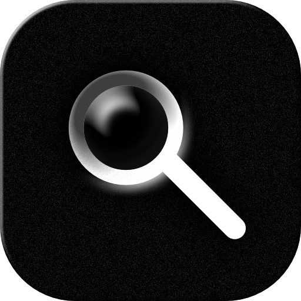
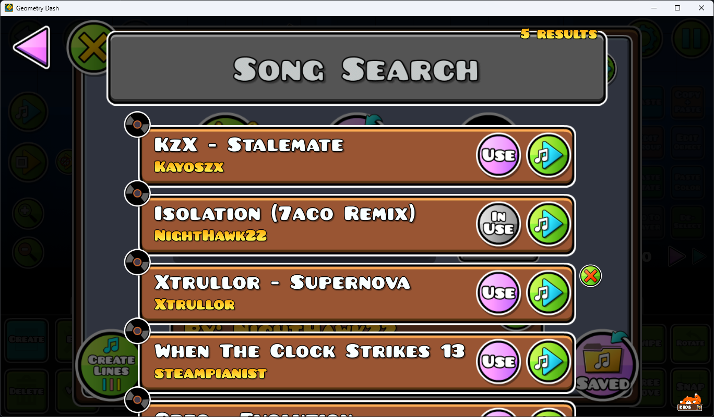

<p align="center"></p>

# Song Search (Geode port)

> This mod was ported to geode using AI. If you don't like using AI ported mods, feel free to not use it.

A Geode port of matcool's **song-search** from
[small-gd-mods](https://github.com/matcool/small-gd-mods).

The original is a Windows-only DLL that hooks `CustomSongLayer::onSongBrowser` at a
hardcoded offset using MinHook + `gd.h` + `cocos-headers`. This port replaces that with
Geode's `$modify` hooking, so it works across GD versions and platforms instead of
breaking on every game update.

Replaces the editor's song browser with a searchable, scrollable list of your
downloaded songs.



## Features

| Feature | Notes |
|---|---|
| Fuzzy search | Ranks results across **song name + artist**; ported from matcool's vendored `fts_fuzzy_match.h` |
| Long titles | Shrink dynamically to fit — nothing runs under the row's buttons; absurdly long names get a clean "..." fallback |
| Preview / select / delete | Per-row play button, select-to-use, and delete with confirmation |
| Jukebox NONG support | Pins Jukebox's disc on each row's top-left corner; clicking it opens Jukebox's nong picker for that song |
| Settings | Toggle NONG symbols, or disable the mod entirely |
| Scrolling | Mouse wheel + drag, with a recycled widget pool to keep scrolling smooth |

Everything except the NONG symbols works with no other mods installed.

## Jukebox / AutoNong integration

Jukebox (`fleym.nongd`) ships **no public query API** for other mods — no `api`
section in its `mod.json`, and its headers are private — so the port does not
reimplement NONG storage or hook Jukebox's internals. Instead it mirrors Jukebox's
look directly:

1. Jukebox draws a pin disc on every song widget it manages (verified against its
   3.8.0 source: `setupJBSW()` adds it unconditionally — it opens the nong picker;
   it is not a "has a nong" badge).
2. The port ships its own copy of that disc artwork (`resources/nong_disc.png`, from
   the MIT-licensed Jukebox repository) and pins it on each row's top-left corner.
   No cross-mod sprite-sheet lookups, no file scraping — so the icon can never render
   as a missing-texture placeholder.
3. Clicking the disc opens Jukebox's own nong picker for that song. Since Jukebox
   exposes no callable API, the port builds a throwaway `CustomSongWidget` for the
   song and activates the same disc button Jukebox attaches to it; the picker owns
   that widget while it is open, so nothing is leaked or double-freed.

This is a hard **no-op when Jukebox is not installed** — checked via
`Loader::get()->getLoadedMod("fleym.nongd")` — so the feature cannot break the mod for
people without Jukebox.

## Building

Geode Windows mods need Clang 19+ (or MSVC 19.44+) targeting `x86_64-pc-windows-msvc`.
GCC/MinGW will not work — the ABI is incompatible.

The reference build here was done **cross-compiling on Kaggle's CPU-only notebooks**,
because the machine this was ported on had no Windows toolchain. The full recipe lives
in [`.kaggle/skills/geode-kaggle-crossbuild/SKILL.md`](.kaggle/skills/geode-kaggle-crossbuild/SKILL.md)
— a reusable skill covering clang + clang-cl, `xwin`, the
[matcool/clang-msvc-sdk](https://github.com/matcool/clang-msvc-sdk) toolchain, the Geode
SDK/CLI/bindings, `Geode.lib`, the `mod.json` version rules, packaging, and PE
verification.

A working notebook template ships with the skill at
`.kaggle/skills/geode-kaggle-crossbuild/templates/notebook-template.ipynb`.

Normally you don't need any of that, though: pushing to this repo builds all five
platforms (Windows / macOS / iOS / Android 32+64) through GitHub Actions — see
`.github/workflows/multi-platform.yml` — and publishes a combined `.geode` artifact.
The Kaggle recipe is the escape hatch from before this repo had CI.

Short version, if you already have the toolchain:

```bash
export SPLAT_DIR=/path/to/splat
export TOOLCHAIN=/path/to/clang-cl-msvc.cmake
export HOST_ARCH=x86_64
export GEODE_SDK=/path/to/sdk
export GEODE_BINDINGS_REPO_PATH=/path/to/bindings

cmake -DCMAKE_TOOLCHAIN_FILE=$TOOLCHAIN -DCMAKE_BUILD_TYPE=Release \
      -DGEODE_TARGET_PLATFORM=Win64 -G Ninja -B build
cmake --build build --config Release
```

Run the native logic tests before a cross-build (fast feedback, no Windows headers
needed):

```bash
g++ -std=c++20 -I src -o /tmp/logic_test tests/logic_test.cpp && /tmp/logic_test
```

## Layout

```
mod.json              mod metadata, tags, settings
CMakeLists.txt        standard setup_geode_mod build
about.md              in-game description (disclaimer + credits + port notes)
changelog.md          release notes shown in-game
support.md            support info shown in-game
logo.png              mod icon
LICENSE               MIT - original small-gd-mods notice preserved
src/
  main.cpp            search layer, rows, hooks
  fts_fuzzy_match.h   vendored fuzzy matcher (public domain, Forrest Smith)
resources/            Jukebox pin disc (nong_disc.png)
tests/
  logic_test.cpp      pure-C++ checks for search/label-fit/scroll-clamp logic
.kaggle/              Kaggle build recipe + the geode-kaggle-crossbuild skill
.github/workflows/    cross-platform CI build
```

## Support

If you like the mod, you can support me on Ko-fi: **[ko-fi.com/notlousy](https://ko-fi.com/notlousy)**.
No pressure at all — using it and reporting bugs is already plenty.

## Credits

- **matcool** — [small-gd-mods](https://github.com/matcool/small-gd-mods), the original mod
- **Fleym & Flafy** — [Jukebox](https://github.com/Fleeym/jukebox) and [AutoNong](https://github.com/FlafyDev/auto-nong), for the NONG support (the bundled pin-disc artwork is from Jukebox, MIT)
- **Forrest Smith** — `fts_fuzzy_match.h`, the public-domain fuzzy matcher
- **deadderp** — playtesting

## License

MIT — see [LICENSE](LICENSE). The original [small-gd-mods](https://github.com/matcool/small-gd-mods) is MIT licensed (© 2021 mat); its notice is preserved in the LICENSE file.
